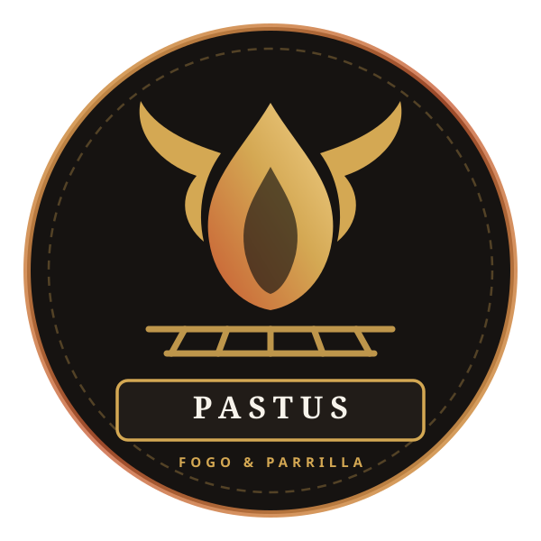

<p align="center">
  
</p>

<h1 align="center">Pastus Fogo &amp; Parrilla · Cardápio &amp; Experiência Digital</h1>

<p align="center">
  Explore os cortes da parrilla, descubra harmonizações, simule sua mesa e faça sua reserva no BH Outlet (Belvedere).
</p>

<p align="center">
  <a href="https://coletivo-inspira.github.io/pastus/">Abrir o site</a> ·
  <a href="./docs/ARQUITETURA.md">Arquitetura &amp; Dados</a> ·
  <a href="./docs/PESQUISA-E-UX.md">Busca e UX</a>
</p>

## O que o portal faz

- **Cardápio interativo completo:** busca instantânea por prato, corte da parrilla, ingrediente, código ou faixa de preço, sem diferenciar acentos.
- **Filtros por seção e perfil:** filtre por *Cortes da Parrilla*, *Entradas*, *Pratos Principais*, *Acompanhamentos*, *Sanduíches*, *Saladas* e *Sobremesas*, além de tags como *Assinatura do Chef*, *Dry Aged*, *Para Compartilhar*, *Vegetariano* e *Até R$ 60*.
- **Harmonização e acompanhamentos:** cada prato sugere guarnições e cortes complementares presentes no próprio cardápio.
- **Descoberta por cartões (Swipe):** escolha as seções desejadas e deslize cartões para montar o pedido da mesa.
- **Minha Mesa (Simulador de pedido e divisão):** salve os pratos escolhidos (incluindo o ponto/molho dos cortes da parrilla), calcule o total estimado com ou sem 10% de serviço, simule a divisão por pessoa e envie a seleção direto para o WhatsApp de reservas.
- **Páginas dedicadas:** `o-restaurante.html` (horários, endereço no BH Outlet, cozinha do chef Cristóvão Laruça) e `eventos.html` (Pastus Lounge às sextas, Pastus Sunset aos sábados e eventos corporativos/sociais).

## Executar localmente

Requer **Node.js 22** (ou 18+) e npm.

```bash
npm ci
npm run dev
```

Para validar os testes automatizados e o build de produção:

```bash
npm test
npm run build
npm run preview
```

O site é publicado pelo GitHub Pages a partir de `dist/` via `.github/workflows/static.yml`. Pull requests executam testes e build no workflow `.github/workflows/ci.yml`.

## Atualizar o cardápio

A fonte editável é `data/cardapio.csv`. O JSON publicado é `public/data/menu.json`.

```bash
npm run import-menu
```
